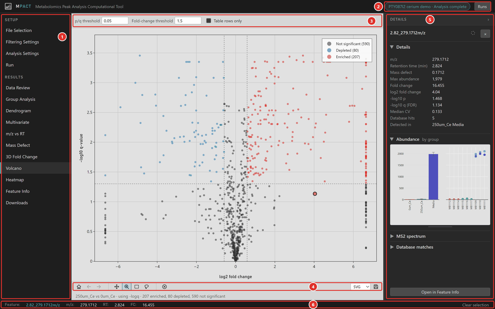
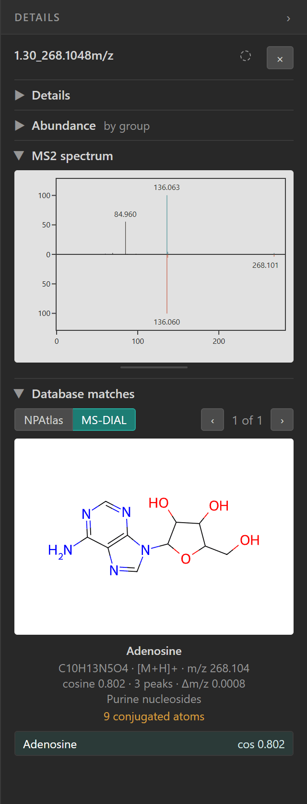

# The interface

<figure markdown="span">
  
  <figcaption markdown="span">The MPACT window. Numbers match the list below.</figcaption>
</figure>

1. **Sidebar.** The **Setup** tabs (File Selection, Filtering Settings,
   Analysis Settings, Run) are the workflow, top to bottom. The **Results** tabs
   are disabled until an analysis completes.
2. **Run chip and Runs.** The chip shows the analysis you are looking at and
   its state. **Runs** opens the list of your previous analyses. See
   [Running and managing runs](../setup/running.md).
3. **Plot controls.** Options for the current plot, such as thresholds, views
   and colour maps. Changes redraw the plot immediately.
4. **Plot toolbar.** Navigation, selection tools and image export. See below.
5. **Details panel.** Information about the selected feature: m/z, retention
   time, statistics, abundance by group, MS2 spectrum and database matches.
6. **Status bar.** The selected feature (or, on plots of samples, the selected
   injection) stays here while you move between tabs.

The same layout is used on every result tab, so a feature selected on the
volcano plot is still selected when you open the heatmap or Feature Info.

## Plot toolbar

| Button | Action |
|---|---|
| :material-home-outline: Reset view | Return to the full extent of the plot |
| :material-arrow-left: :material-arrow-right: Back, Forward | Step through previous zoom and pan states |
| :material-arrow-all: Pan | Drag to move the plot |
| :material-magnify-plus-outline: Zoom | Drag a rectangle to zoom in (the default) |
| :material-selection: Box select | Drag a rectangle to select the features inside it |
| :material-lasso: Lasso select | Draw around features to select them |
| :material-close-circle-outline: Cancel selection | Leave the box or lasso tool |
| Format, :material-content-save-outline: Save | Save the plot as SVG, PNG, JPEG or WebP |

Hold ++shift++ with the box or lasso tool to add to the current selection.
SVG export is the best choice for figures, since it stays sharp at any size and
can be edited in a vector program.

## The details panel

The panel has four collapsible sections. Close the ones you are not reading to
make room for the others.

- **Details:** m/z, retention time, mass defect, maximum abundance, fold change,
  p and q values, median CV, database hit count and the groups the feature was
  detected in.
- **Abundance:** average abundance per biological group with its propagated
  uncertainty (left), and the individual sample values (right).
- **MS2 spectrum:** the feature's fragment spectrum, if you supplied a fragment
  database. After an MS/MS library search it is drawn as a mirror plot against
  the best library match.
- **Database matches:** Natural Products Atlas and MS-DIAL library hits, with
  structures. Step through them with the arrows.

Drag the boundary between the panel and the plot to resize it, or double-click
the boundary to reset its width. The **›** button in the panel header hides it
for a full-width plot; **‹ Details** at the right edge brings it back. Its size
and open sections are remembered.

The dashed circle next to the feature name flags the feature. See
[Flags](../results/index.md#flags).

<figure markdown="span">
  { width="320" }
  <figcaption markdown="span">The details panel. The feature's MS2 spectrum (top) is mirrored against the matching MS-DIAL library spectrum (bottom), and the match is listed below.</figcaption>
</figure>

## Links

The address bar always names the current tab and analysis, for example
`app.mpactms.org/#volcano/r_fa0bc6e750adf5ce`. Bookmark it or reload the page
and you return to the same view. Analyses belong to your workspace, so a link
opens only for you, not for someone you send it to.
