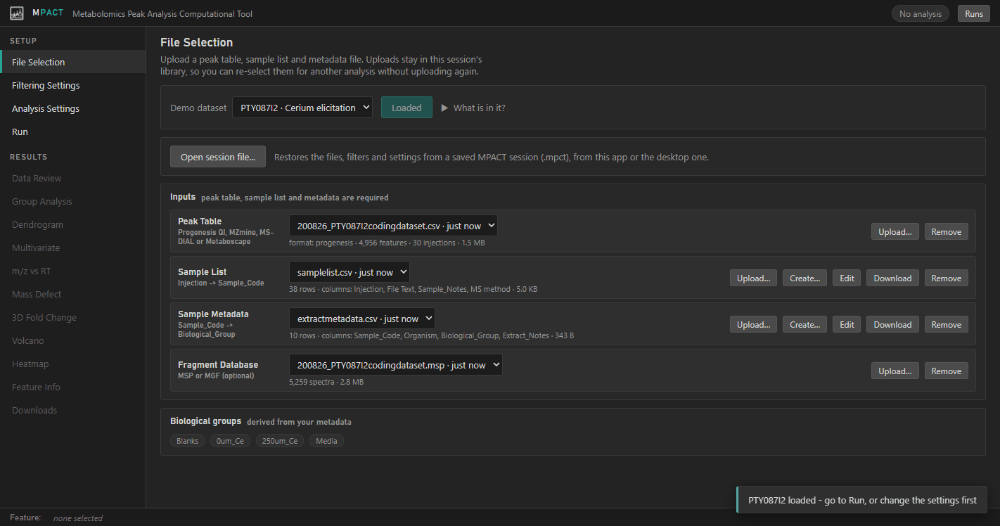

# Quick start

This walks through one complete analysis using the built-in demo dataset. It
takes about five minutes.

The demo, PTY087I2, is a *Streptomyces* elicitation study: a solvent blank, a
media control, and cultures grown with 0 µM and 250 µM cerium, each in
biological and technical triplicate. It has about 4,950 features across 30
injections and comes with an MS/MS fragment database.

## 1. Sign in

Open [app.mpactms.org](https://app.mpactms.org). Enter your email address and
type in the six-digit code that is sent to you. The first sign-in creates your
account, and there is no password to remember.

A self-hosted server may use a shared access code or no sign-in at all. See
[Sign-in and accounts](../self-hosting/authentication.md).

## 2. Load the demo dataset

On **File Selection**, leave **PTY087I2 · Cerium elicitation** selected in the
**Demo dataset** list and click **Load**. All four input slots fill in, and the
biological groups found in the metadata appear at the bottom of the page.

<figure markdown="span">
  
  <figcaption markdown="span">File Selection after loading the PTY087I2 demo dataset. All four slots are filled and the biological groups are listed at the bottom.</figcaption>
</figure>

## 3. Check the settings

The defaults suit the demo, so you can skip this step. To see what they are:

- **Filtering Settings** turns on all four filters, uses `Blanks` as the blank
  group, and sets the CV threshold to 0.2.
- **Analysis Settings** chooses the two groups the statistics compare. For this
  dataset, set **Experimental Group** to `250um_Ce` and **Control Group** to
  `0um_Ce`.

## 4. Run the analysis

Open **Run**, optionally type a label such as `Cerium demo`, and click **Run**.
The pipeline's log streams into the page while it works. The demo finishes in
a few seconds, and the chip in the top bar changes to **Analysis complete**.

## 5. Explore the results

The tabs under **Results** in the sidebar are now enabled.

1. **Data Review** reports how many features each filter removed and how
   reproducible the data are.
2. **Volcano** shows which features change between the two groups you chose.
   Click a point to open its details in the panel on the right.
3. **Feature Info** lists every feature in a sortable table. The first time
   you open it, features are matched against the Natural Products Atlas by
   mass. Click **Search MS/MS** to match their fragment spectra against the
   MS-DIAL library as well.
4. **Downloads** has every output file, including a `.mpct` session file that
   reopens the analysis later.

## Next steps

- [The interface](interface.md) explains the layout and how selection works.
- [Input files](../setup/input-files.md) explains how to prepare your own data.
