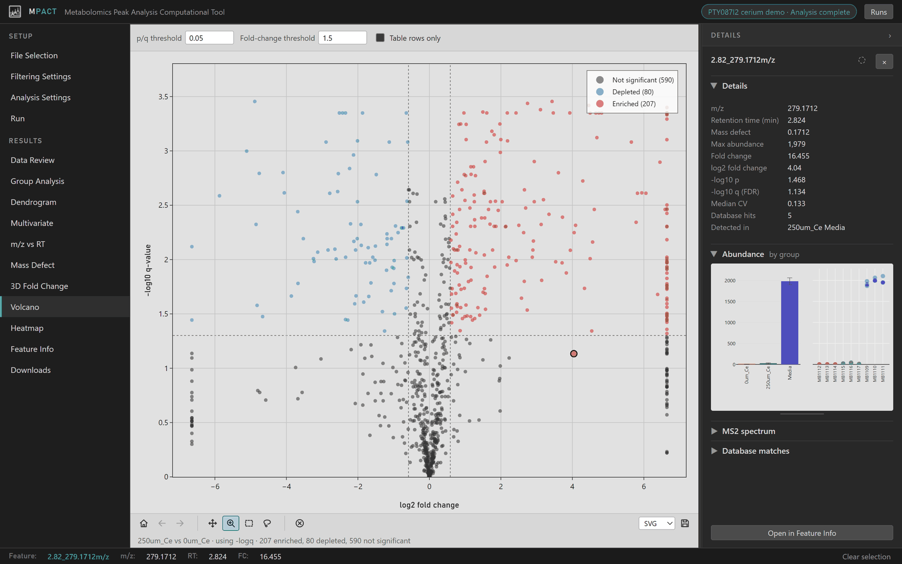

# MPACT

MPACT (Metabolomics Peak Analysis Computational Tool) filters and explores
untargeted LC-MS metabolomics data. You give it a peak table, a sample list and
a metadata file. It removes mispicked peaks, solvent-blank features,
irreproducible features and in-source fragments, computes group statistics, and
draws interactive plots for data quality, group comparison, clustering,
multivariate analysis, mass defect and per-feature database matching.

<figure markdown="span">
  
  <figcaption markdown="span">The volcano plot for the demo dataset, with one feature selected and its details in the panel on the right.</figcaption>
</figure>

The hosted version runs at **[app.mpactms.org](https://app.mpactms.org)**. The
analysis runs on the server, so there is nothing to install and a large dataset
behaves the same on a laptop as on a workstation. You can also
[run your own server](self-hosting/index.md).

## Supported inputs

| Input | Formats |
|---|---|
| Peak table | Progenesis QI, MZmine, MS-DIAL (5.4 and 5.5), Bruker Metaboscape |
| Sample list | CSV: injection name to sample code |
| Metadata | CSV: sample code to biological group |
| Fragment database (optional) | MSP or MGF |

Formats are detected from file content. See [Input files](setup/input-files.md).

## Where to start

- **New to MPACT:** see [Installation](getting-started/installation.md) for the
  ways to run it, then try the demo dataset in the
  [Quick start](getting-started/quick-start.md).
- **Analyzing your own data:** [Input files](setup/input-files.md) covers how to
  export a peak table and build the two sample sheets.
- **Reading a plot:** each result tab has its own page under
  [Results](results/index.md).
- **Used the desktop app before:** see
  [Coming from the desktop app](reference/desktop-app.md).
- **Something not working:** see [Troubleshooting](reference/troubleshooting.md).

## License

MPACT is free software under the GNU General Public License v3. The analysis
pipeline is shared with the desktop application at
[github.com/robertsamples/mpact](https://github.com/robertsamples/mpact).
