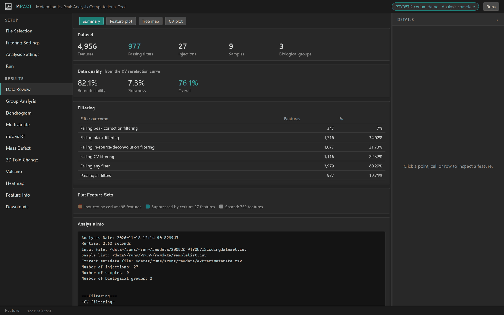
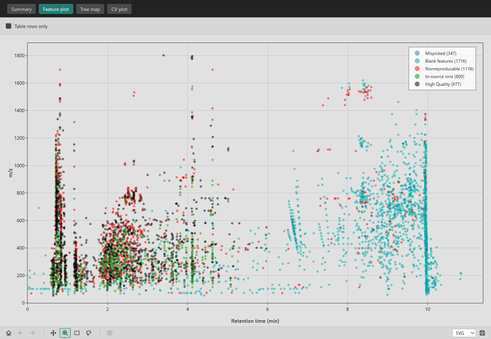
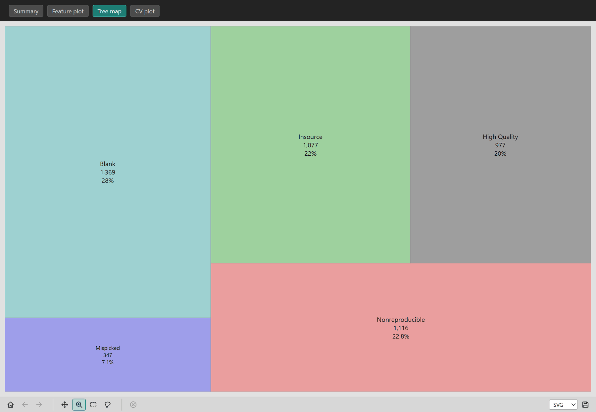
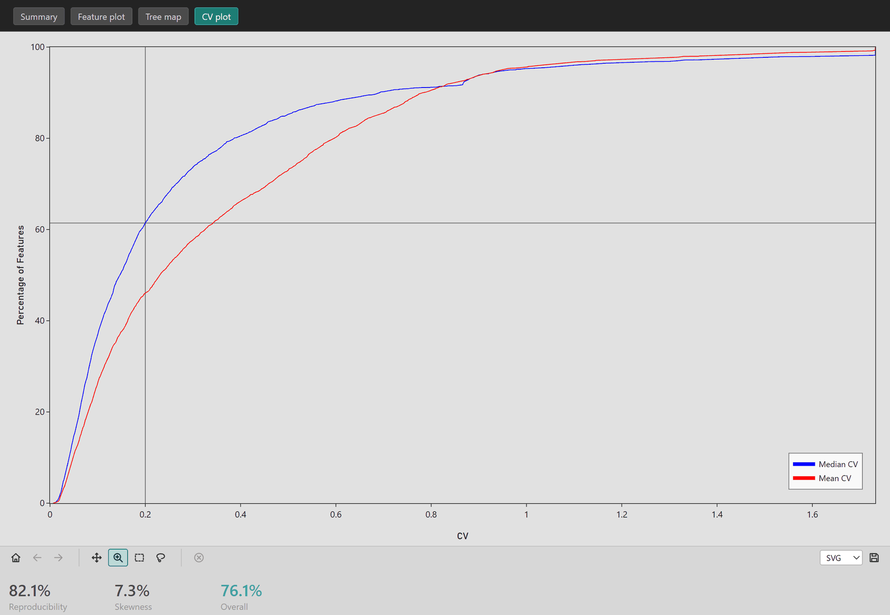

# Data Review

An overview of data quality and of what the filters removed. It has four
views: **Summary**, **Feature plot**, **Tree map** and **CV plot**.

## Summary

<figure markdown="span">
  
  <figcaption markdown="span">The Data Review summary for the demo dataset.</figcaption>
</figure>

- **Dataset:** features in the peak table, features that passed every filter,
  and the numbers of injections, samples and biological groups used.
- **Data quality:** three scores from the CV plot (below).
- **Filtering:** how many features failed each filter. A feature can fail more
  than one, so the rows add up to more than the total.
- **Plot Feature Sets:** how many features each set matched.
- **Analysis info:** the run's parameters, the same text as `analysisinfo.txt`
  in [Downloads](downloads.md).

## Feature plot

Every feature in the peak table at its m/z and retention time, coloured by the
filter that removed it. Features that passed every filter are drawn in black as
**High Quality**.

<figure markdown="span">
  
  <figcaption markdown="span">Every feature in the peak table, coloured by the filter that removed it. Black features passed every filter.</figcaption>
</figure>

Use it to see where in the chromatogram each filter acts. A filter that removes
most features in one narrow region is worth a look in the raw data.

## Tree map

The share of features removed by each filter, as areas.

<figure markdown="span">
  
  <figcaption markdown="span">Share of features removed by each filter.</figcaption>
</figure>

## CV plot

The cumulative percentage of features (y) against their coefficient of
variation across technical replicates (x), drawn for both the median CV (blue)
and the mean CV (red). The crosshair marks the CV threshold and the fraction of
features under it.

<figure markdown="span">
  
  <figcaption markdown="span">Cumulative distribution of median CV (blue) and mean CV (red). The crosshair marks the CV threshold.</figcaption>
</figure>

How to read it:

- A curve that rises steeply near zero means most features are reproducible.
- A wide gap between the mean and median curves means the distribution is
  skewed: a few samples reproduce much worse than the rest.
- A shallow curve, with few features under 0.2 to 0.3, often means alignment
  problems.
- A sharp step partway up suggests inconsistent detection between replicate
  sets.

The three scores below the plot summarize it:

| Score | Meaning |
|---|---|
| Reproducibility | Area under the curve, relative to the CV expected from counting noise alone for this number of replicates. Higher is better. |
| Skewness | The gap between the mean and median curves. Lower is better. |
| Overall | Reproducibility × (1 − Skewness), as a percentage. |
