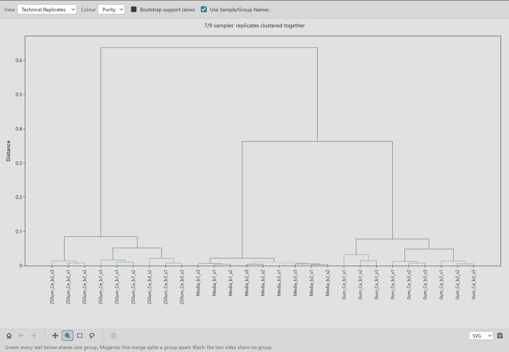
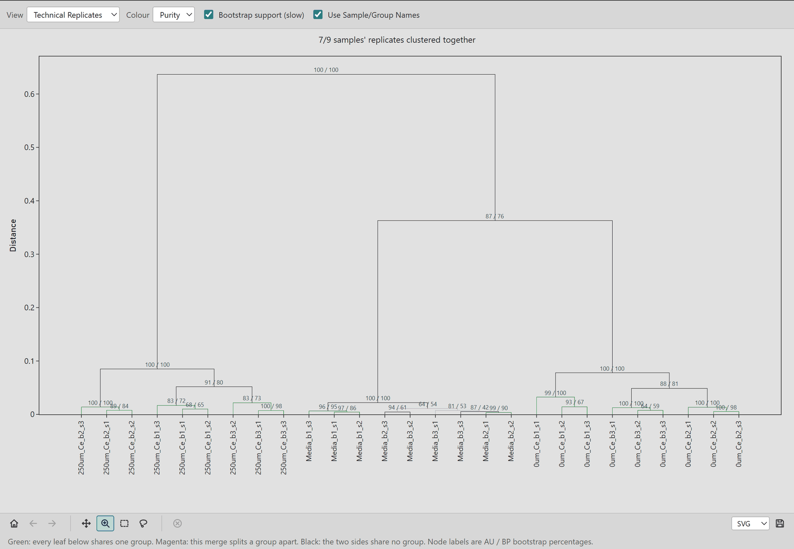

# Dendrogram

Hierarchical clustering (Ward's method) of the injections or samples. If the
biological differences in your study are larger than the technical noise,
technical replicates should cluster together after filtering. That makes the
dendrogram a good check on the
[CV threshold](../setup/filtering.md#cv-reproducibility-filtering).

<figure markdown="span">
  
  <figcaption markdown="span">Dendrogram of every injection with purity colouring. Green branches join replicates of one sample; magenta branches mark where two samples' replicates are mixed.</figcaption>
</figure>

## Controls

**View**

- **Technical Replicates** (default): one leaf per injection, to check whether
  each sample's injections agree.
- **Biological Replicates**: injections averaged first, one leaf per sample, to
  check whether samples group by treatment.

**Colour**

- **Purity** (default). A branch is green when every leaf below it belongs to
  the same sample (or, in the Biological Replicates view, the same group). A
  branch is magenta at the exact point where two samples' replicates are mixed,
  which is a real sign of poor clustering. Other branches stay black. The title
  counts how many samples are completely clustered, for example
  "7/9 samples' replicates clustered together".
- **None**: a plain dendrogram.

Magenta is used rather than red so that the colours stay distinct for readers
with red-green colour blindness.

**Bootstrap support (slow)** resamples the data 1,000 times and labels each
branch with two percentages: the approximately unbiased p-value (AU) and the
bootstrap probability (BP). An AU above 95 is usually taken as strong support
for that cluster. It takes noticeably longer on large datasets.

<figure markdown="span">
  
  <figcaption markdown="span">The same dendrogram with bootstrap support. Each branch is labelled AU / BP.</figcaption>
</figure>

In the demo, the cerium groups cluster cleanly, while the media control's
replicates overlap (the magenta branches).
