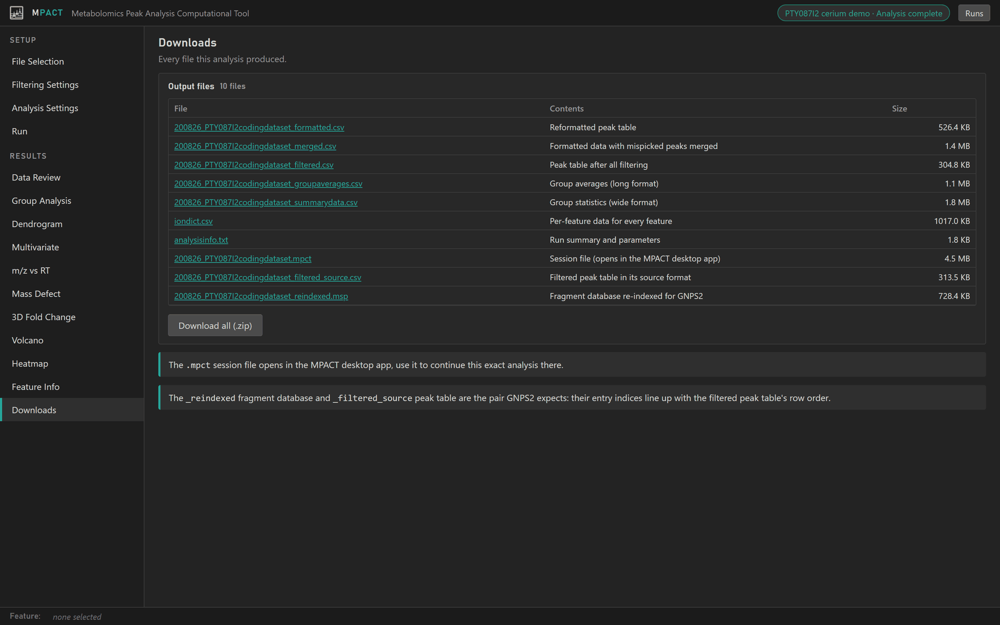

# Downloads

Every file the analysis produced. Click a file name to download it, or
**Download all (.zip)** for the whole set.

<figure markdown="span">
  
  <figcaption markdown="span">The Downloads tab for the demo analysis.</figcaption>
</figure>

## Output files

Most files are named after the peak table (`<name>` below) and are indexed by
feature ID, m/z and retention time.

| File | Contents |
|---|---|
| `<name>_formatted.csv` | The peak table converted to MPACT's internal layout |
| `<name>_merged.csv` | The formatted table with mispicked peaks merged into their parents (when **Merge Peaks** is on) |
| `<name>_filtered.csv` | The table after every filter (normalized, when [sample normalization](../setup/analysis-settings.md#sample-normalization-beta) is on) |
| `<name>_filtered_raw.csv` | Only with sample normalization: the filtered table before normalization |
| `<name>_normfactors.csv` | Only with sample normalization: each sample's relative signal and the factor applied |
| `<name>_groupaverages.csv` | Average abundance of each feature in each group, in long format |
| `<name>_summarydata.csv` | Every group statistic in wide format: average abundance per group, biological and technical relative standard deviations and n, the combined uncertainty, and the effective n (Welch-Satterthwaite) |
| `iondict.csv` | One row per feature, including those removed by filters: m/z, retention time, mass defect, which filters it passed, median CV, groups detected in, maximum abundance, fold change, −log p, −log q and database hit count |
| `analysisinfo.txt` | Run summary and every parameter, as shown on the [Data Review](data-review.md#summary) tab |
| `adduct_attribution.csv` | Only when the [beta adduct filter](../setup/filtering.md#beta-adduct-filter) was on: each group's kept feature and the ion forms removed for it |
| `<name>.mpct` | Session file with the input files and settings |
| `<name>_filtered_source.csv` | The original peak table, cut down to the features that passed filtering |
| `<name>_reindexed.msp` / `.mgf` | The fragment database renumbered to match the filtered peak table |

The re-indexed fragment file is written only when a fragment database was
supplied.

## Session files

The `.mpct` file holds the input files and every setting. Open it with
**Open session file...** on [File Selection](../setup/file-selection.md#opening-a-session-file)
to set the same analysis up again, here or on another MPACT server. It also
opens in the MPACT desktop app.

## GNPS2 files

GNPS2 feature-based molecular networking needs a peak table and a fragment
file whose entries are in the same order. `_filtered_source` and `_reindexed`
are that pair, already matched, so they can be uploaded to GNPS2 as they are.

Peak tables from MZmine, MS-DIAL and Metaboscape are converted to the
Progenesis layout at the start of each run, so for those `_filtered_source` is in
the Progenesis layout too. Choose Progenesis as the input format in GNPS2.
