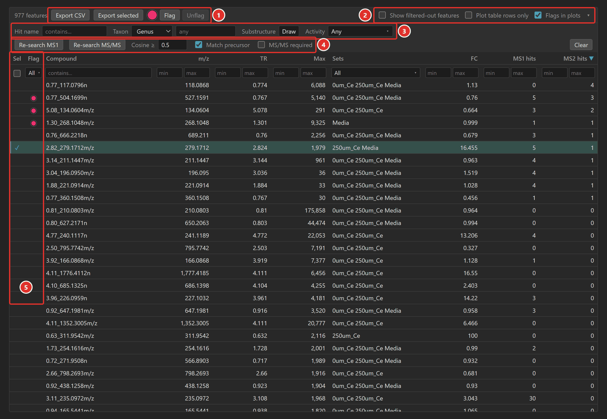
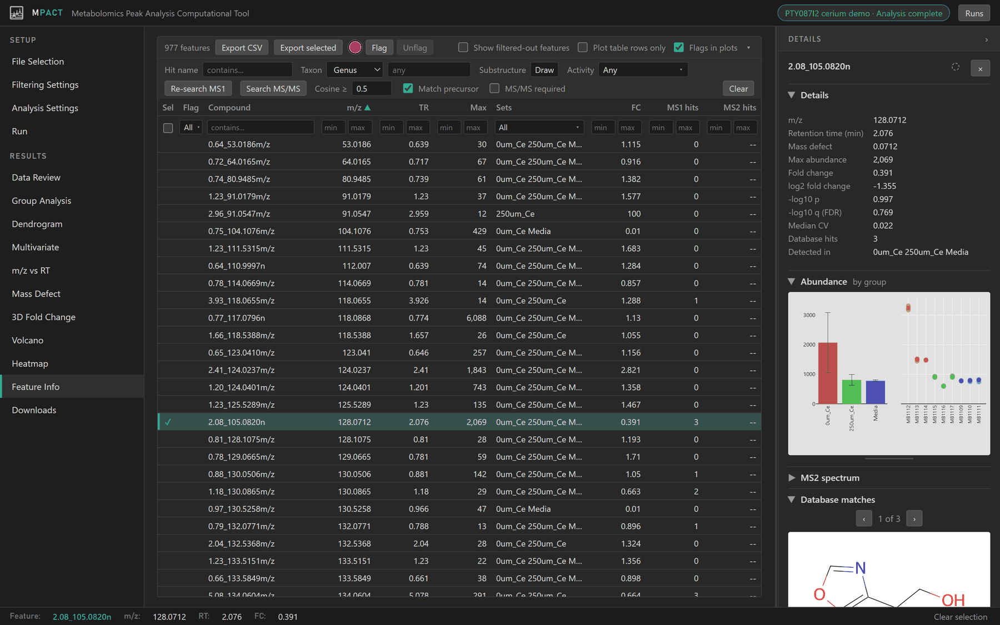

# Feature Info

Every feature in one table, with the [details panel](../getting-started/interface.md#the-details-panel)
beside it. The table holds the whole dataset at once rather than in pages, and
the arrow keys move through it.

<figure markdown="span">
  
  <figcaption markdown="span">The Feature Info table. Numbers match the list below.</figcaption>
</figure>

1. **Export and flags.** **Export CSV** saves the table as currently filtered
   and sorted. **Export selected** saves only the selected features. Both
   include every per-feature column from the run plus each feature's best
   NPAtlas and MS/MS library match. With features selected, pick a colour and
   click **Flag** or **Unflag**.
2. **Display.** **Show filtered-out features** adds the features removed by
   the filters, which are hidden by default. **Plot table rows only** limits
   every plot to the rows listed here. **Flags in plots** marks flagged
   features on the plots. The **▾** button hides or shows the filter rows.
3. **Hit filters.** List only features with a database match that meets every
   criterion you set. See [Filtering by database match](#filtering-by-database-match).
4. **Searches.** Run or re-run the MS1 and MS/MS searches. See below.
5. **Sel and Flag columns.** **Sel** ticks the selected features; click a tick
   to add or remove that row. **Flag** shows each feature's flag colour; click
   the cell to flag that row with the current colour.

## Columns

| Column | Contents |
|---|---|
| Compound | Feature ID from the peak table |
| m/z, TR | m/z and retention time (min) |
| Max | Highest group-average abundance |
| Sets | Biological groups the feature was detected in |
| FC | Fold change, experimental over control |
| MS1 hits | Number of NPAtlas compounds within the ppm window |
| MS2 hits | Number of MS-DIAL library spectra matched (after an MS/MS search) |

Click a heading to sort by it, and again to reverse the order. Clicking **Sel**
or **Flag** lists selected or flagged features first, with the other sort still
applied within each part.

The row under the headings filters each column: text for Compound, minimum and
maximum for numbers, and a group list for Sets. The **Sel** box lists only the
selected features. The **Flag** list can show only certain flag colours (tick)
or hide them (cross). **Clear** resets every filter.

## Database searches

### MS1 search (Natural Products Atlas)

The first time you open Feature Info, every feature is matched against the
[Natural Products Atlas](https://www.npatlas.org) by mass: a compound is a hit
when its `[M+H]+` or `[M+Na]+` ion is within the ppm threshold set in
[Analysis Settings](../setup/analysis-settings.md#database-search). The count
fills the **MS1 hits** column, and the hits themselves, with structures and
source organisms, appear under **Database matches** in the details panel.
**Re-search MS1** runs the search again.

### MS/MS library search

Available when the run has a [fragment database](../setup/input-files.md#fragment-database).
**Search MS/MS** compares each feature's MS2 spectrum with the MS-DIAL MS/MS
library and fills the **MS2 hits** column. Matches appear in the details panel
under the **MS-DIAL** tab of **Database matches**, and the MS2 spectrum is
drawn as a mirror plot against the best match.

- **Cosine ≥** (default 0.5): the minimum spectral similarity for a match.
- **Match precursor** (on by default): only library spectra whose precursor is
  within the ppm window are considered. Turn it off for an analogue search,
  which compares against the whole library with a modified cosine that also
  matches fragments shifted by the precursor mass difference. It finds related
  compounds with different masses, up to 200 Da apart.
- **MS/MS required:** list only features that have an MS2 spectrum.

## Filtering by database match

The hit filters keep a feature when at least one of its NPAtlas hits meets
every criterion you set.

- **Hit name:** part of the compound name.
- **Taxon:** a taxonomic level and name, such as genus *Streptomyces*. Start
  typing for suggestions.
- **Substructure:** click **Draw** to sketch a structure, or type SMILES or
  SMARTS. Only hits containing that substructure are kept.
- **Activity:** one or more compound classes.
    - **Electrophile:** contains a reactive group such as an epoxide,
      β-lactone, β-lactam, Michael acceptor, quinone, aldehyde or isocyanate.
    - **Siderophore:** listed in the SIDERITE siderophore database.
    - **Chromophore:** a conjugated system of at least the given number of
      atoms (default 14).

Combine these with **Plot table rows only** to see where, for example,
features with a *Streptomyces* electrophile hit fall on the volcano plot.

<figure markdown="span">
  
  <figcaption markdown="span">Feature Info with one feature selected. Its details, abundance and NPAtlas matches are shown in the panel on the right.</figcaption>
</figure>
