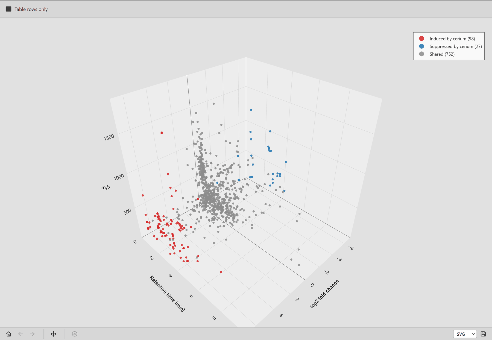

# 3D Fold Change

Each feature's m/z, retention time and log2 fold change (experimental over
control, as set in [Analysis Settings](../setup/analysis-settings.md#statistics)),
coloured by Plot Feature Set.

<figure markdown="span">
  
  <figcaption markdown="span">m/z, retention time and log2 fold change, coloured by Plot Feature Set.</figcaption>
</figure>

Use it to find groups of features that share mass, polarity and the direction
of change. Drag to rotate and scroll to zoom.
**Table rows only** limits the plot to the features listed in
[Feature Info](feature-info.md).
