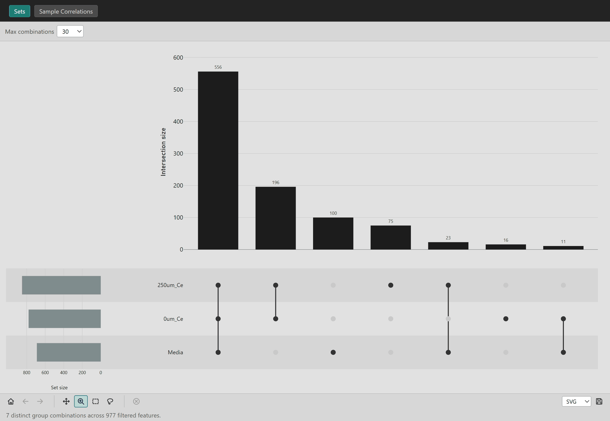
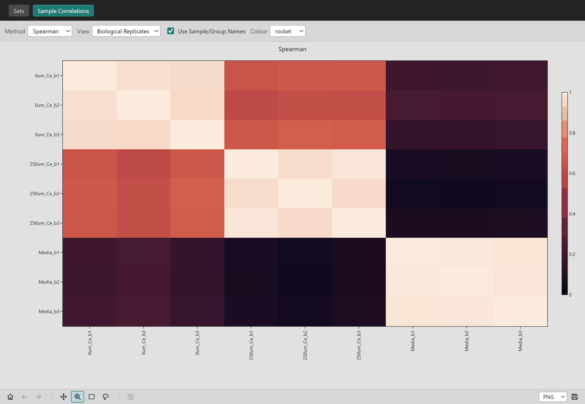

# Group Analysis

How the biological groups overlap and how similar they are. Two views:
**Sets** and **Sample Correlations**.

## Sets

An UpSet plot of which features are detected in which groups. Each column is
one combination of groups, marked by the dots underneath; the bar above it is
the number of features found in exactly that combination. The bars on the left
are the total number of features in each group.

<figure markdown="span">
  
  <figcaption markdown="span">UpSet plot of the demo dataset. Each column counts the features found in exactly the combination of groups marked by the dots below it.</figcaption>
</figure>

In the demo, 556 features are shared by all three groups, and 100 are found
only in the media control. **Max combinations** limits how many columns are
drawn, largest first.

"Detected" uses the presence threshold from
[Filtering Settings](../setup/filtering.md#blank-filtering-and-group-parsing).
The blank group is not shown when blank filtering is on.

## Sample Correlations

A matrix of how similar every pair of samples is.

<figure markdown="span">
  
  <figcaption markdown="span">Spearman correlation between biological replicates in the demo dataset.</figcaption>
</figure>

- **Spearman** (default): rank correlation of abundance profiles. It suits
  LC-MS data, whose abundances are far from normally distributed. The colour
  scale runs from 0 to 1 because real samples almost always correlate
  positively.
- **Jaccard**: similarity of which features are present, ignoring how much.
- **Bray-Curtis**: abundance-weighted similarity, the usual measure in ecology
  and the one NMDS uses on the [Multivariate](multivariate.md) tab.

**View**

- **Biological Replicates** (default): technical replicates are averaged, one
  row per sample.
- **Individual Injections**: one row per injection.
- **Biological Groups**: one row per group.

**Use Sample/Group Names** replaces injection file names with short labels:
`<group>_b<n>` for the nth biological replicate and `<group>_b<n>_s<m>` for its
mth injection. **Colour** changes the colour map.

Click a cell to select that sample's injection.
