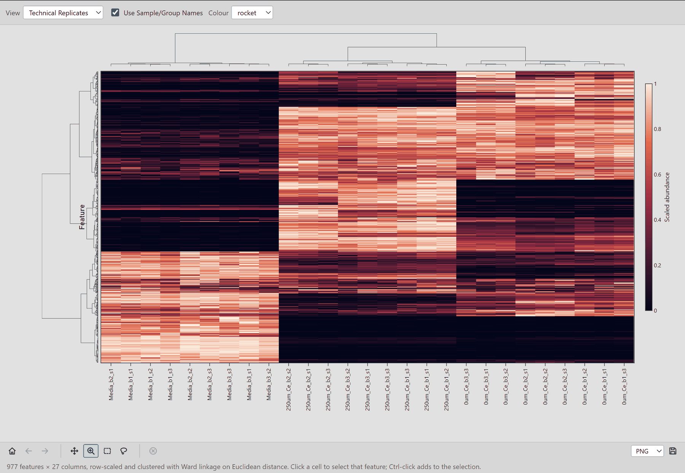

# Heatmap

Every filtered feature (rows) in every injection, sample or group (columns).
Each row is scaled between its own minimum and maximum, then rows and columns
are both clustered (Ward linkage, Euclidean distance).

<figure markdown="span">
  
  <figcaption markdown="span">Row-scaled, clustered heatmap of every filtered feature across every injection. Lighter cells are more abundant.</figcaption>
</figure>

Columns that cluster together have similar overall profiles, like the
[Dendrogram](dendrogram.md), although the order can differ slightly because the
heatmap uses scaled data. Rows that cluster together rise and fall together
across samples, which makes co-regulated groups of features easy to pick out.

## Controls

- **View:** **Technical Replicates** (one column per injection),
  **Biological Replicates** (one per sample) or **Biological Groups** (one per
  group).
- **Use Sample/Group Names:** short `<group>_b<n>_s<m>` labels instead of
  injection file names.
- **Colour:** the colour map. All six options are perceptually uniform.

Click a cell to select its feature; ++ctrl++ + click adds to the selection.

Very large datasets are drawn with at most 1,500 rows by default. Past that,
neighbouring rows in the clustered order are averaged for display. The limit
is a server setting
(`MPACT_MAX_HEATMAP_ROWS`).
