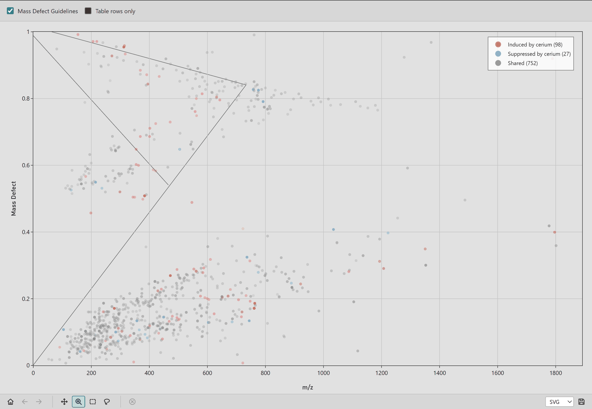
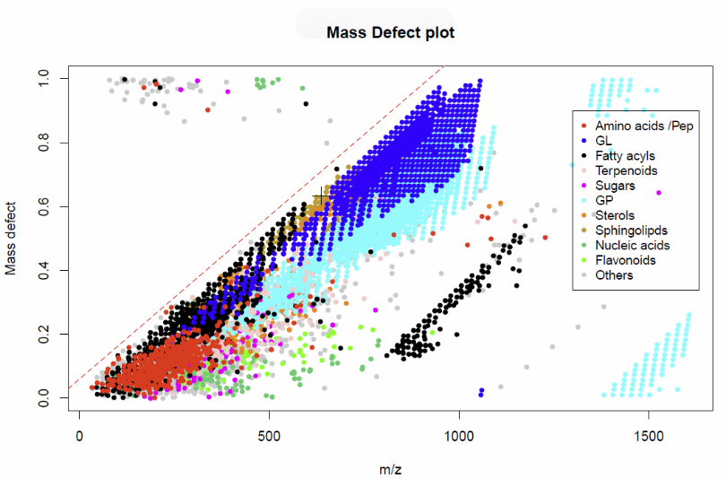

# Mass Defect

Each feature's mass defect (its m/z minus the nominal, integer mass) against
its m/z, coloured by [Plot Feature Set](../setup/analysis-settings.md#plot-feature-sets).

<figure markdown="span">
  
  <figcaption markdown="span">Mass defect against m/z, coloured by Plot Feature Set, with the reference guidelines shown.</figcaption>
</figure>

## Why mass defect is useful

A given chemical change (adding a methyl group, hydrogenation, hydrolysis)
always shifts mass and mass defect by the same amounts. Families of related
compounds therefore line up along the same slope, which makes the plot useful
for spotting compound series and prioritizing features.

Elements contribute differently to mass defect per dalton of mass. Hydrogen is
strongly positive (+7.825 mDa/Da), carbon is zero by definition, and heavier
atoms are increasingly negative (nitrogen +0.220, oxygen −0.317,
sulfur −0.873 mDa/Da). So the slope a series traces hints at its chemistry:

- **Low slope:** heteroatom-rich compounds such as nucleotides and
  carbohydrates, or hydrogen-poor cyclic polyketides.
- **High slope:** hydrogen-rich compounds such as hydrocarbons, fatty acids
  and other lipids.

<figure markdown="span">
  { width="560" }
  <figcaption markdown="span">Where classes of [RefMet](https://www.metabolomicsworkbench.org) metabolites fall on a mass defect plot.</figcaption>
</figure>

## Guidelines

**Mass Defect Guidelines** draws three reference lines: saturated hydrocarbons,
perbromocarbons and polycarbonic acids.

- Singly charged ions made of C, H, N, O, P and S fall between the hydrocarbon
  line and the polycarbonic acid line.
- Heavily halogenated, hydrogen-poor compounds fall between the polycarbonic
  acid and perbromocarbon lines.
- Singly charged ions made of C, H, N, O, P, S, Cl and I cannot fall between
  the perbromocarbon and hydrocarbon lines.

## Wrap-around

Nominal mass is the floor of the m/z, so mass defect always lies between 0 and
1. A compound rich in halogens or heteroatoms can have a small *negative* true
mass defect, which appears just below 1. Many large molecules, such as long
fatty acids, have a true mass defect above 1, which wraps around to a small
value.

Two common patterns: a series with a negative slope near the top of the plot is
usually salt clusters, and a cloud about 0.5 below the main cluster is usually
doubly charged ions.
