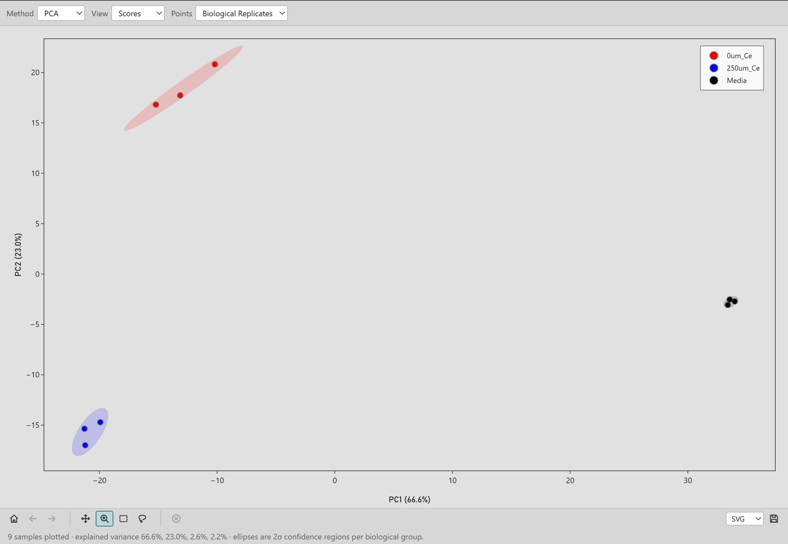
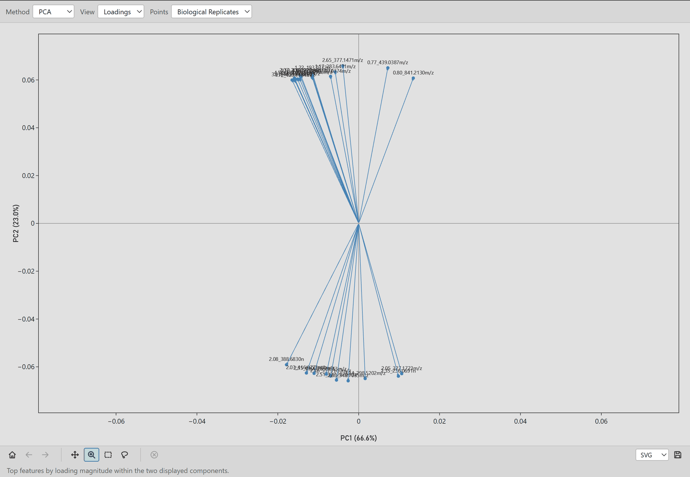

# Multivariate

Reduces the samples-by-features matrix to two dimensions so you can see which
samples resemble each other.

<figure markdown="span">
  
  <figcaption markdown="span">PCA scores of the demo samples. Ellipses mark each group's 2σ confidence region.</figcaption>
</figure>

## Controls

**Method**

- **NMDS** (default): non-metric multidimensional scaling on Bray-Curtis
  dissimilarity, using raw abundances. It is rank-based, so the axes have no
  percentage; the title reports the stress instead.
- **PCA**: principal component analysis on mean-centred, unit-variance-scaled
  features. Axis labels give the percentage of variance each component
  explains.
- **PLS-DA**: partial least squares discriminant analysis, supervised by
  biological group. Use it when PCA shows overlapping groups but you expect a
  real difference and want the direction that separates them best.

**View**

- **Scores** (default): one point per sample, coloured by group, with an
  ellipse marking each group's 2σ confidence region.
- **Loadings**: the 25 features that contribute most to the two displayed
  components, as arrows from the origin. A feature selected elsewhere is
  marked here too.

<figure markdown="span">
  
  <figcaption markdown="span">PCA loadings: the 25 features that contribute most to the two displayed components.</figcaption>
</figure>

- **Biological Replicates** (default): technical replicates are averaged, one
  point per sample.
- **Individual Injections**: one point per injection, useful for spotting a
  single bad injection.

Clicking a score point selects that injection, which is then shown in the
status bar.
