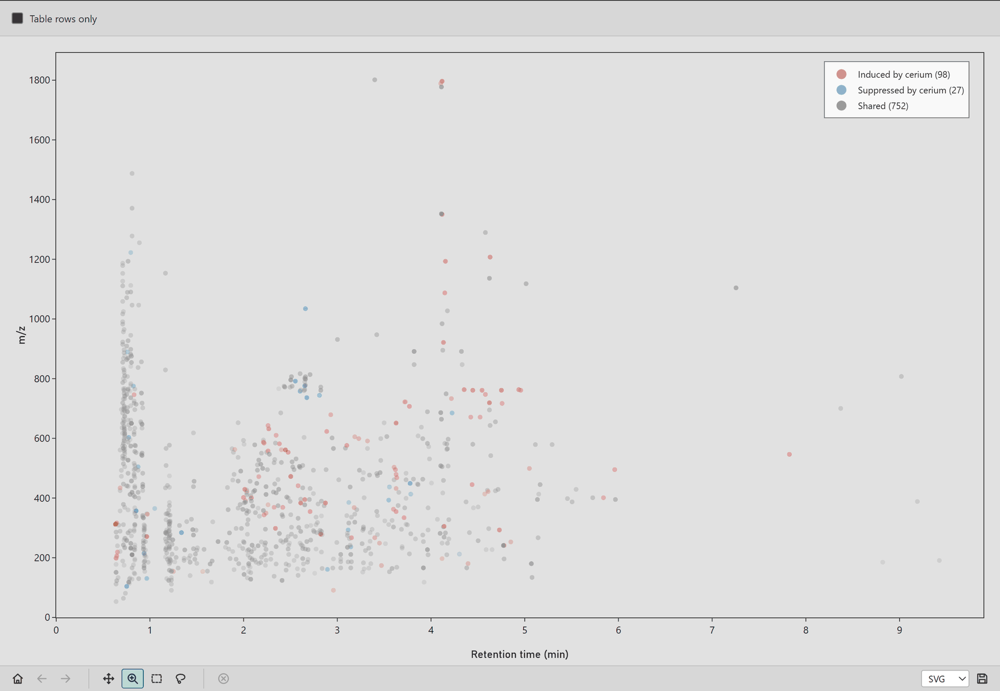

# m/z vs RT

Every filtered feature at its m/z (y) and retention time (x), coloured by
[Plot Feature Set](../setup/analysis-settings.md#plot-feature-sets). Opacity
follows log abundance, so abundant features are drawn more solidly.

<figure markdown="span">
  
  <figcaption markdown="span">m/z against retention time, coloured by Plot Feature Set. More abundant features are drawn more solidly.</figcaption>
</figure>

Retention time is a rough proxy for polarity, so the plot shows whether the
features unique to one condition share a mass range or polarity.

**Table rows only** limits the plot to the features listed in
[Feature Info](feature-info.md). See [Working with results](index.md#table-rows-only).
