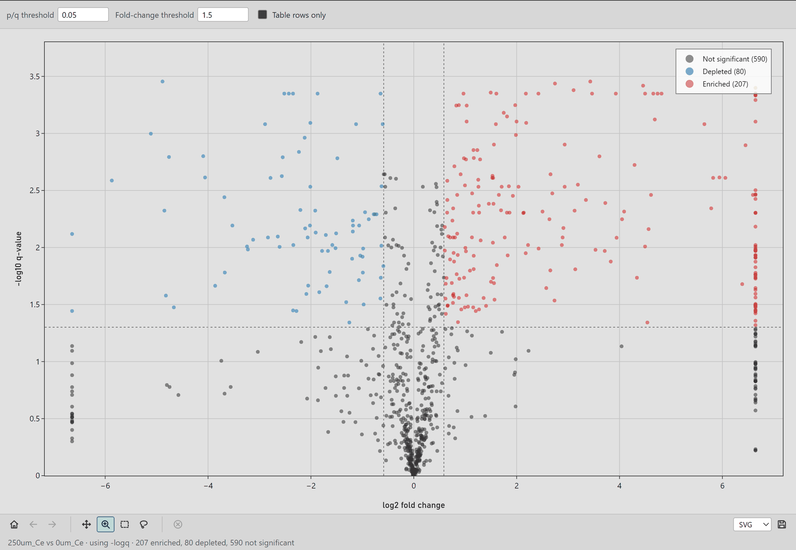

# Volcano

log2 fold change (x) against −log10 of the FDR-corrected q value (y) for the
two groups chosen in [Analysis Settings](../setup/analysis-settings.md#statistics).
Features significantly higher in the experimental group are **Enriched** (red),
significantly lower ones are **Depleted** (blue), and the rest are grey.

<figure markdown="span">
  
  <figcaption markdown="span">Volcano plot of 250 µM against 0 µM cerium. Features enriched in the experimental group are red and depleted features are blue.</figcaption>
</figure>

## Controls

| Control | Default | Meaning |
|---|---|---|
| p/q threshold | 0.05 | Significance cut-off, drawn as the horizontal dashed line |
| Fold-change threshold | 1.5 | Minimum fold change either way, drawn as the two vertical dashed lines (±log2 1.5) |
| Table rows only | off | Plot only the features listed in [Feature Info](feature-info.md) |

The line under the plot names the comparison and counts the features in each
class.

Features detected in only one of the two groups have no finite fold change.
They are given a fold change of 100 (or 0.01) and line up in columns at the
left and right edges.

## How the statistics are computed

Fold change is the ratio of the two groups' average abundances. The t-test
uses an uncertainty that combines the technical variation (between injections
of one sample) and the biological variation (between samples of one group),
added in quadrature, with effective degrees of freedom from the
Welch-Satterthwaite equation. If a dataset has only technical or only
biological replicates, the available variation is used on its own. q values are
Benjamini-Hochberg corrected across the plotted features.

The per-group statistics for every feature are in `_summarydata.csv` on the
[Downloads](downloads.md) tab.
