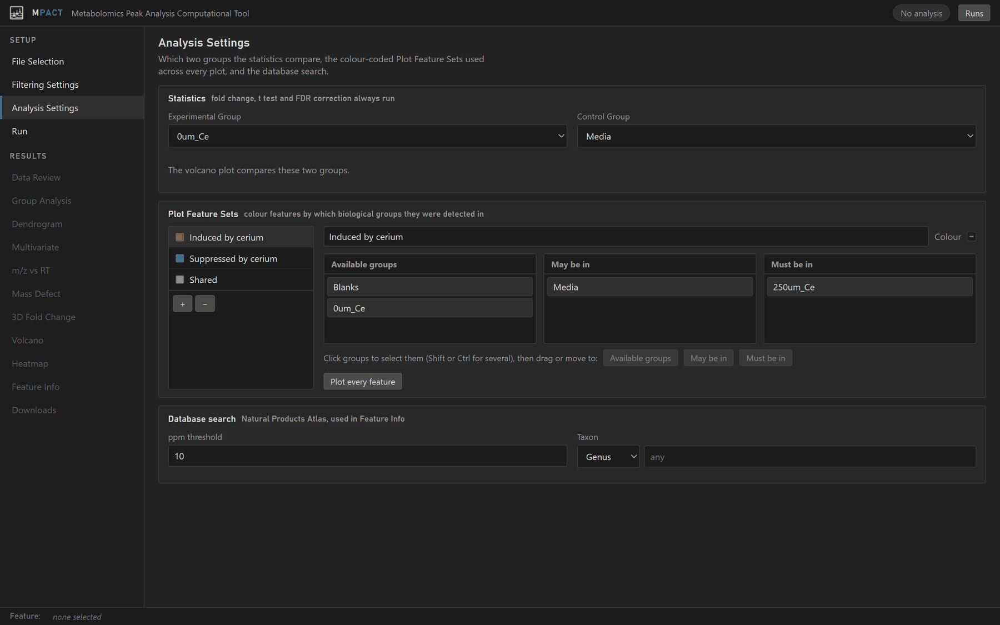
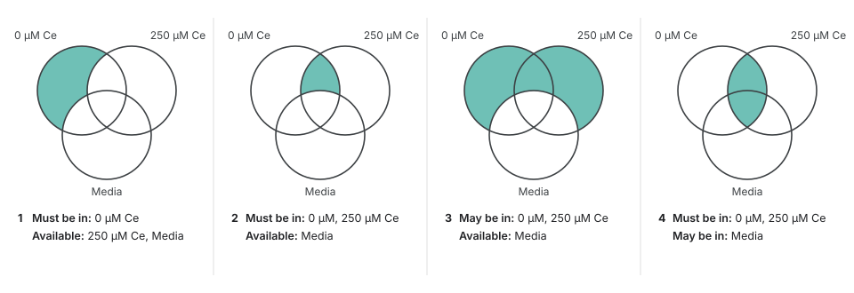

# Analysis Settings

<figure markdown="span">
  
  <figcaption markdown="span">Analysis Settings with three Plot Feature Sets defined.</figcaption>
</figure>

## Statistics

Choose the **Experimental Group** and **Control Group**. Fold change
(experimental over control), a t-test and Benjamini-Hochberg false discovery
rate correction are always computed for this pair. They drive the
[Volcano](../results/volcano.md) and [3D Fold Change](../results/fold-change-3d.md)
plots and the fold-change column in [Feature Info](../results/feature-info.md).

## Sample normalization (beta)

Scales each biological sample so that samples of different concentration can
be compared, for example extracts diluted differently, or products where sugar
or another bulk ingredient dilutes everything else. Off by default.

- **Probabilistic quotient** (recommended): each sample's factor is the median,
  over features, of its abundance divided by that feature's median across
  samples (Dieterle et al., *Anal. Chem.* 2006, 78, 4281). A few compounds that
  differ a lot between samples do not move it.
- **Total signal**: each sample is scaled so its summed abundance matches the
  median sample. Compounds that are much more abundant in some samples are read
  as a concentration difference.

The factors are worked out after filtering, from the features that passed
every filter, so solvent, blank and noise peaks do not set them. One factor
applies to all injections of a sample, so technical CVs do not change, and the
filters, which run before it, see the measured abundances. Group averages,
statistics and plots use the normalized values.

**Leave Out** lists the groups that are not scaled and are not used to work
out the other samples' factors. The blank group is always left out. Tick any
other group that is not a diluted version of the samples, such as a media
blank: it shares only traces of the samples' compounds, so it would otherwise
read as very dilute and be scaled up many times over. The CHM350 datasets come
with their media blank already ticked.

Normalization assumes most compounds are at similar levels in every sample
once dilution is taken out. Groups that really do differ in how much they
make, such as two strains, break that assumption, and normalizing would remove
the difference. The run warns when any sample's signal is more than 5 times
above or below the median sample; check those are dilutions, or leave their
groups out.

Two extra downloads are written: `<name>_normfactors.csv`, with each sample's
signal relative to the median sample and the factor applied, and
`<name>_filtered_raw.csv`, the filtered table before normalization. The
relative signal is an estimate of relative concentration, but matrix effects
such as ion suppression change it too, so check it against an internal
standard or a dilution series before reading it as a dilution factor.

## Plot Feature Sets

Plot Feature Sets decide which colour each feature is drawn in on the m/z vs
RT, mass defect, 3D fold change and other feature plots, based on the groups
it was detected in. Each set has a name, a colour, and three lists of groups:

| List | A matching feature is |
|---|---|
| **Must be in** | detected in every one of these groups |
| **May be in** | detected or not; these groups do not matter |
| **Available groups** | detected in none of these groups |

"Detected" uses the presence threshold from
[Filtering Settings](filtering.md#blank-filtering-and-group-parsing). A
feature that matches several sets is drawn once in each.

<figure markdown="span">
  
  <figcaption markdown="span">Four example Plot Feature Sets and the features each one colours (shaded). Groups left in Available groups must not contain the feature.</figcaption>
</figure>

To edit the sets:

- **+** adds a set and **−** removes the selected one. Click a set in the list
  to edit it.
- Type a name in the box above the lists and pick a **Colour**.
- Click a group to select it (++shift++ or ++ctrl++ for several), then drag it
  to another list or use the buttons under the lists.
- **Plot every feature** moves every group except the blank group into
  **May be in**, so the set colours every feature that survived filtering.

If you define no sets, one is made for you: *Features not in blanks* when
blank filtering is on, otherwise *All features*.

## Database search

Settings for matching features against the Natural Products Atlas (NPAtlas) in
[Feature Info](../results/feature-info.md).

- **ppm threshold** (default 10): the mass tolerance. A feature matches a
  compound when its m/z is within this many ppm of the compound as one of the
  ticked ion forms.
- **Ion forms**: which ions a feature is searched as. The list follows the
  [ion mode](filtering.md#ion-mode). Positive mode starts with `[M+H]+` and
  `[M+Na]+`; negative mode with `[M-H]-` and `[M+Cl]-`. Ticking more forms
  finds more matches, including more by chance.
- **Taxon**: limit matches to compounds reported from one taxon, at the level
  chosen (kingdom to species). Start typing to see suggestions. Leave it empty
  to search every compound.

The ppm threshold is fixed when the analysis runs. The taxon can also be
changed afterwards with the hit filters on the Feature Info tab.
