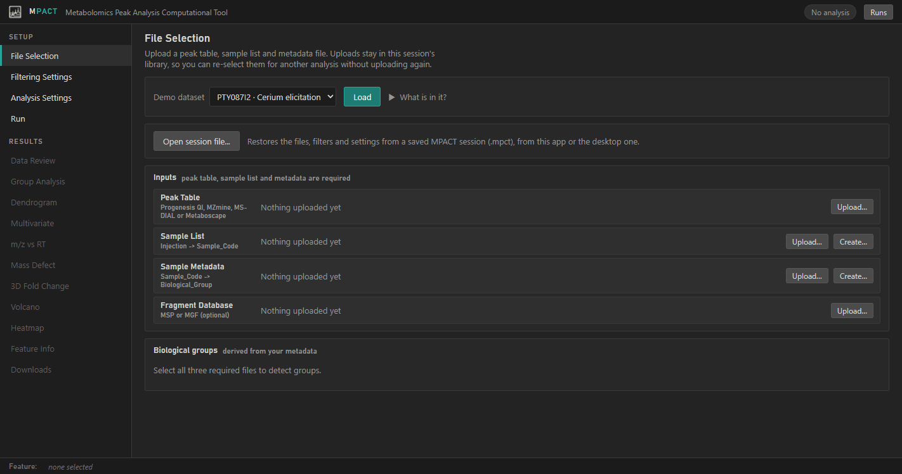
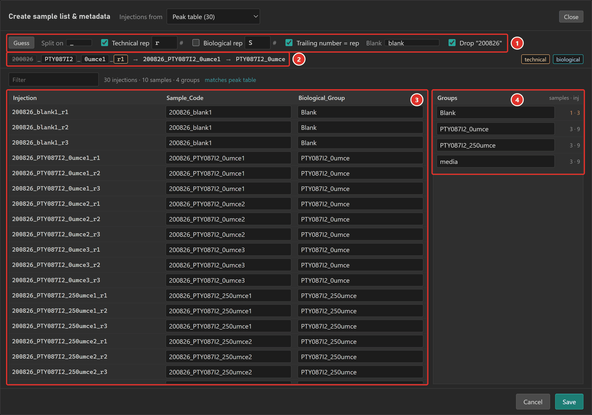

# File Selection

<figure markdown="span">
  
  <figcaption markdown="span">File Selection before any files are uploaded.</figcaption>
</figure>

The page has four input slots: **Peak Table**, **Sample List**, **Sample
Metadata** and the optional **Fragment Database**. When all three required
files are selected, the biological groups found in the metadata are listed at
the bottom of the page.

## Uploading files

Click **Upload…** in a slot, or drag a file onto it. Each file is checked when
it arrives:

- the peak table's format is detected and its features and injections are
  counted,
- the sample list and metadata are checked for their required columns,
- the fragment database's spectra are counted.

A problem is reported in the slot straight away, before you run anything.

Uploads go into your **library**. The drop-down in each slot lists every file
of that kind you have uploaded, so you can run the same peak table again with
different settings without uploading it again. **Remove** deletes a file from
the library. Analyses that already used it keep their own copy.

The sample list and metadata slots also have **Edit** (change cells in place),
**Download** and **Create…** (see below).

## Demo datasets

The **Demo dataset** list loads a ready-made example. **What is in it?**
describes the selected dataset.

- **PTY087I2** fills all four slots. It is used in the
  [Quick start](../getting-started/quick-start.md).
- Some servers list additional datasets, such as a class's own alignments.
  These may fill only the peak table and fragment slots, leaving you to create
  the sample list and metadata. Some also set up the comparison groups and Plot
  Feature Sets for you.

## Creating the sample list and metadata

**Create…** in either sheet slot opens an editor that builds both sheets from
the injection names. Most injection names already encode the sample and the
replicate, for example `200826_PTY087I2_0umce1_r1`: sample `0umce1`, technical
replicate `r1`.

<figure markdown="span">
  
  <figcaption markdown="span">The sample sheet editor. Numbers match the list below.</figcaption>
</figure>

1. **Naming rules.** **Guess** detects them from the names. **Split on** sets
   the delimiter characters. **Technical rep** and **Biological rep** give the
   marker before each replicate number (`r` for `_r1`, `S` for `_S1`).
   **Trailing number = rep** treats a trailing number as the replicate, so
   `media1`, `media2`, `media3` become one group. This only applies where the
   numbers run 1 to n, so an ID like `CR13` is left alone. Names containing a
   **Blank** term all go to the `Blank` group. **Drop** removes a prefix every
   name shares, such as a date.
2. **Example.** One injection name split into tokens, with the sample code and
   group it produces. Click a numbered token to mark it as the technical
   replicate, then the biological replicate, then neither.
3. **Table.** The resulting sample code and biological group for every
   injection. Any cell can be overwritten. The line above the table counts
   injections, samples and groups and says whether the names match the peak
   table.
4. **Groups.** Each group with its sample and injection counts. Rename a group
   here to rename it everywhere.

**Injections from** chooses where the names come from: the selected peak table,
an existing sample list, or an instrument sequence file (`.csv`, `.txt` or
`.tsv`). **Save** writes both sheets to your library and selects them.

If the selected sample list also covers other datasets, the rows for other
injections are kept unchanged when you save.

## Opening a session file

**Open session file...** restores the files, filters and settings from a
`.mpct` file. Session files come from the [Downloads](../results/downloads.md)
tab or from the MPACT desktop app. After opening one, check the settings and
click **Run** to reproduce the analysis.
