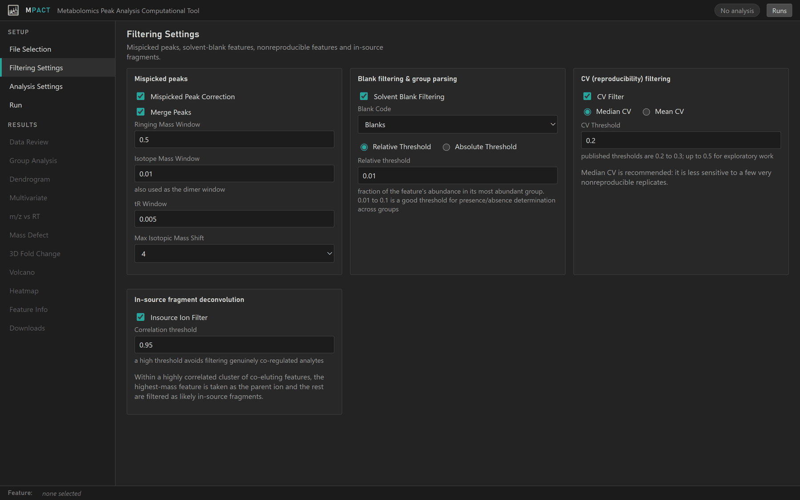
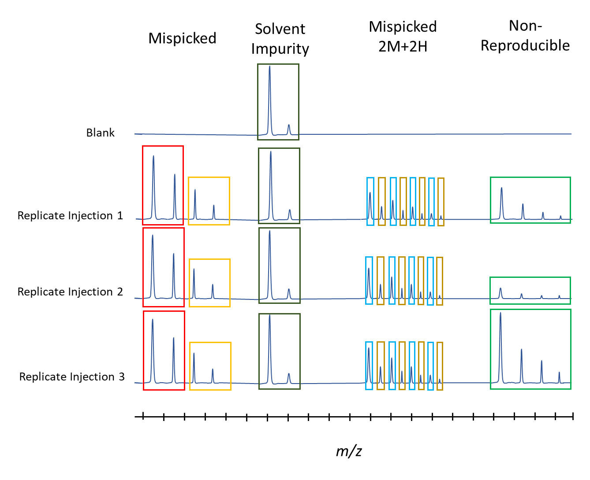

# Filtering Settings

MPACT removes unwanted features before computing statistics. Each filter can
be turned off. The [Data Review](../results/data-review.md) tab reports how
many features each one removed.

Four options are marked **beta**: the mass defect filter, the isotope filter,
the adduct filter and the CV sample cutoff. They are newer than the published
MPACT pipeline. The mass defect filter and the CV sample cutoff are on by
default; the isotope and adduct filters are off.
With all of them off, a run uses the published pipeline unchanged.

## Ion mode

Set **Ion mode** to Positive or Negative to match the data. It is used by the
adduct filter and by the [database search](analysis-settings.md#database-search).
If the selected peak table or fragment file states its polarity and it differs
from the setting, a notice offers to switch.

Negative mode is beta. The MS/MS library holds positive-mode spectra only, so
the MS/MS library search is not available for a negative-mode run.

<figure markdown="span">
  
  <figcaption markdown="span">Filtering Settings with the default values.</figcaption>
</figure>

## Mispicked peaks

A mispicked peak is a feature that is really part of another, more abundant
feature at a lower m/z and the same retention time. Common causes are an
isotope pattern split into several features during peak picking, FT-MS ringing
artifacts beside an intense peak, and doubly charged dimers.

| Setting | Default | Meaning |
|---|---|---|
| Mispicked Peak Correction | on | Detect mispicked peaks and remove them |
| Merge Peaks | on | Add a mispicked peak's abundance to its parent feature instead of discarding it |
| Ringing Mass Window | 0.5 | Width (Da) of the mass-difference bands that count as ringing or isotope peaks |
| Isotope Mass Window | 0.01 | Tolerance (Da) for isotope spacing; also used for the half-integer offset of doubly charged dimers |
| tR Window | 0.005 | Maximum retention-time difference (min) from the parent |
| Max Isotopic Mass Shift | 4 | How many Da above the parent to look |

The defaults are deliberately conservative, so that closely related but
genuinely different compounds are not merged.

### Beta isotope filter

Ticking **Beta isotope filter** runs it in place of the mispicked peak
correction. The correction's own settings are kept and come back when the box
is unticked.

The beta filter looks for the same three kinds of peak, but removes a feature
only when it is weaker than the co-eluting feature it belongs to:

- **Isotope**: the mass difference is a whole number of 13C spacings (1.00335)
  within the mass tolerance, and the feature is weaker than its parent.
- **Doubly charged**: the mass difference is close to a half-integer, the
  feature is weaker than its parent, and the two correlate across samples.
- **Ringing**: the feature is within the ringing window above its parent and
  below the ringing intensity limit.

| Setting | Default | Meaning |
|---|---|---|
| Merge Peaks | on | Add a removed peak's abundance to its parent feature |
| tR Window | 0.005 | Maximum retention-time difference (min) from the parent; shared with the standard correction |
| Isotope Mass Tolerance | 3 | ppm around each multiple of the 13C spacing |
| Isotope Peaks per Feature | 3 | How many isotope peaks above the parent to look for |
| Ringing Window | 800 | ppm above the parent in which a peak can be ringing |
| Ringing Intensity Limit | 0.01 | A ringing peak is weaker than this fraction of the parent |
| Isotope Intensity Limit | 0.7 | An isotope peak is no stronger than this fraction of the parent |
| Doubly Charged Tolerance | 0.02 | Da around the half-integer mass difference |
| Correlation Threshold | 0.75 | Pearson r across samples; shared with the adduct filter |
| Correlation p Value | 0.05 | The correlation must be significant below this |

The beta filter removes far fewer features than the standard correction. On
MS-DIAL data it found about a tenth as many of MS-DIAL's own isotope
annotations as the standard correction did, so treat it as experimental.

## Blank filtering and group parsing

**Solvent Blank Filtering** removes features present in the group chosen as
**Blank Code**.

The threshold below it decides when a feature counts as *present* in a group.
It is used for blank filtering and also for every group comparison later on:
the Plot Feature Sets, the UpSet plot and the "Detected in" lists.

- **Relative Threshold** (default 0.01): a fraction of the feature's abundance
  in its most abundant group. 0.01 to 0.1 is a reasonable range. A value of
  0.05 means a feature found in the blank at more than 5% of its highest group
  abundance is treated as a blank feature.
- **Absolute Threshold**: a raw or normalized abundance value.

## CV (reproducibility) filtering

Removes features whose coefficient of variation (relative standard deviation)
across technical replicates is above the **CV Threshold** (default 0.2).

- **Median CV** (recommended) uses the median across samples, so one
  badly reproduced sample does not remove an otherwise good feature.
- **Mean CV** uses the mean.

Published thresholds are usually 0.2 to 0.3. For exploratory work, few samples
or chemically diverse extracts where many features appear in only a few
samples, up to 0.5 can be appropriate. The [Dendrogram](../results/dendrogram.md)
helps choose: pick the least strict threshold beyond which technical replicates
stop clustering together any better.

### Beta CV filter

The CV of a feature is worked out per sample, across that sample's technical
replicate injections, and then summarised over samples. In a varied set of
samples a compound may be present in a few and picked up at noise level in
many others. Those noise-level CVs are high and can decide the median, so a
well-measured compound fails.

With **Beta CV filter** on, samples whose mean abundance is below the **Sample
Cutoff** times the feature's highest sample mean are left out of its CV. It is
on by default, with a cutoff of 0.01; turn it off for the published CV filter.
`iondict.csv` gains a `CV samples used` column with how many samples each CV
came from.

On a 42,000-feature dataset of 300 extracts with pooled QC injections, a cutoff
of 0.01 to 0.03 brought the median CV closest to the CV measured in the QC
injections. At 0.1 or above, too few samples are left for a reliable CV and
more poorly reproduced features pass.

!!! note "Peak picking thresholds change the CV plot"
    The intensity threshold used for peak picking in Progenesis, MZmine or
    MS-DIAL has a large effect on the [CV plot](../results/data-review.md#cv-plot).
    Picking lower-intensity peaks necessarily brings in more noise-like and
    artifact peaks, which are poorly reproducible, so the curve looks worse and
    the quality scores drop. The reproducible features are still kept
    correctly: the CV filter removes the added noise, and the features that
    pass are the same reproducible subset.

<figure markdown="span">
  { width="560" }
  <figcaption markdown="span">How the filters see a blank and three replicate injections: features split from an isotope pattern (mispicked), a solvent impurity also present in the blank, a doubly charged dimer pattern (mispicked 2M+2H), and a feature whose abundance varies between replicates (non-reproducible).</figcaption>
</figure>

## In-source fragment deconvolution

In-source fragments are ions that break off a molecule in the ion source, so
they appear as separate features at the same retention time. MPACT builds
correlation matrices of features within narrow retention-time windows. Within a
cluster of co-eluting features whose abundances correlate above the
**Correlation threshold** (default 0.95), the highest-mass feature is kept as
the parent ion and the rest are removed.

Keep the threshold high. A low value removes genuinely different compounds that
happen to rise and fall together across samples.

### Beta adduct filter

Ticking **Beta adduct filter** runs it in place of in-source fragment
deconvolution. The deconvolution settings are kept and come back when the box
is unticked.

The adduct filter groups the ion forms of one molecule, such as `[M+H]+`,
`[M+Na]+` and `[M-H2O+H]+`. Two features are grouped when:

- their m/z differ by one of the ticked ion forms, within the m/z tolerance;
- they elute within the tR window of each other; and
- their abundances correlate across samples (Pearson r above the threshold).

The most abundant feature of each group is kept and the others are removed.
Abundances are not summed. The removed features and the feature kept for each
are listed in `adduct_attribution.csv` on the [Downloads](../results/downloads.md)
tab, and each grouped feature's ion form is shown in its details.

| Setting | Default | Meaning |
|---|---|---|
| Ion forms to group | see below | Which mass differences from the base ion count as the same molecule |
| m/z Tolerance | 3 | ppm |
| tR Window | 0.02 | Maximum retention-time difference (min) between forms |
| Correlation Threshold | 0.75 | Pearson r across samples; shared with the isotope filter |

The ion forms offered depend on the ion mode. Positive mode measures from
`[M+H]+` and starts with `[M+Na]+`, `[M+K]+`, `[M+NH4]+`, `[M-H2O+H]+` and
`[M-2H2O+H]+` ticked. Negative mode measures from `[M-H]-` and starts with
`[M+Cl]-`, `[M+FA-H]-`, `[M+Hac-H]-`, `[M-H2O-H]-` and `[M-CO2-H]-` ticked.
Each mode keeps its own ticks.

The ion form labels describe mass differences. The feature labelled as the base
ion is the one the others were measured from, which is not always the
protonated or deprotonated molecule.

<figure markdown="span">
  
  <figcaption markdown="span">In-source fragment deconvolution. Features at the same retention time are grouped by correlation, and the highest-mass feature in each group (red star) is kept as the molecular ion.</figcaption>
</figure>

## Mass defect filtering (beta)

Removes features whose m/z cannot belong to a singly charged molecule made of
C, H, N, O, P and S. These are mostly multiply charged ions, salt clusters and
noise. It is on by default.

The filter allows a band of mass defects that widens with mass. Above about
m/z 690 the band is wider than 1 Da, so every feature passes: the filter only
removes features at lower masses. It runs before the other filters, and the
features it removes take no part in them.

Tested against the Natural Products Atlas, it rejects about 0.1% of known
natural products as `[M+H]+`, most of them halogenated.

| Setting | Default | Meaning |
|---|---|---|
| Mass Defect Filter | on | Remove features with an implausible mass defect |
| Allow halogenated compounds | off | Widen the band for compounds with several Cl or Br. Turn this on for samples where halogenated compounds are expected |
