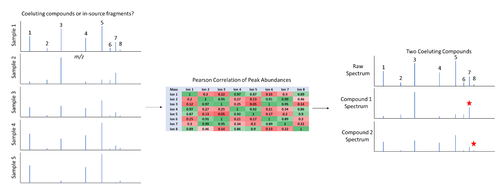

# Filtering Settings

MPACT removes four kinds of unwanted features before computing statistics.
Each filter can be turned off. The [Data Review](../results/data-review.md) tab
reports how many features each one removed.

<figure markdown="span">
  
  <figcaption markdown="span">Filtering Settings with the default values.</figcaption>
</figure>

## Mispicked peaks

A mispicked peak is a feature that is really part of another, more abundant
feature at a lower m/z and the same retention time. Common causes are an
isotope pattern split into several features during peak picking, FT-MS ringing
artifacts beside an intense peak, and doubly charged dimers.

| Setting | Default | Meaning |
|---|---|---|
| Mispicked Peak Correction | on | Detect mispicked peaks and remove them |
| Merge Peaks | on | Add a mispicked peak's abundance to its parent feature instead of discarding it |
| Ringing Mass Window | 0.5 | Width (Da) of the mass-difference bands that count as ringing or isotope peaks |
| Isotope Mass Window | 0.01 | Tolerance (Da) for isotope spacing; also used for the half-integer offset of doubly charged dimers |
| tR Window | 0.005 | Maximum retention-time difference (min) from the parent |
| Max Isotopic Mass Shift | 4 | How many Da above the parent to look |

The defaults are deliberately conservative, so that closely related but
genuinely different compounds are not merged.

## Blank filtering and group parsing

**Solvent Blank Filtering** removes features present in the group chosen as
**Blank Code**.

The threshold below it decides when a feature counts as *present* in a group.
It is used for blank filtering and also for every group comparison later on:
the Plot Feature Sets, the UpSet plot and the "Detected in" lists.

- **Relative Threshold** (default 0.01): a fraction of the feature's abundance
  in its most abundant group. 0.01 to 0.1 is a reasonable range. A value of
  0.05 means a feature found in the blank at more than 5% of its highest group
  abundance is treated as a blank feature.
- **Absolute Threshold**: a raw or normalized abundance value.

## CV (reproducibility) filtering

Removes features whose coefficient of variation (relative standard deviation)
across technical replicates is above the **CV Threshold** (default 0.2).

- **Median CV** (recommended) uses the median across samples, so one
  badly reproduced sample does not remove an otherwise good feature.
- **Mean CV** uses the mean.

Published thresholds are usually 0.2 to 0.3. For exploratory work, few samples
or chemically diverse extracts where many features appear in only a few
samples, up to 0.5 can be appropriate. The [Dendrogram](../results/dendrogram.md)
helps choose: pick the least strict threshold beyond which technical replicates
stop clustering together any better.

!!! note "Peak picking thresholds change the CV plot"
    The intensity threshold used for peak picking in Progenesis, MZmine or
    MS-DIAL has a large effect on the [CV plot](../results/data-review.md#cv-plot).
    Picking lower-intensity peaks necessarily brings in more noise-like and
    artifact peaks, which are poorly reproducible, so the curve looks worse and
    the quality scores drop. The reproducible features are still kept
    correctly: the CV filter removes the added noise, and the features that
    pass are the same reproducible subset.

<figure markdown="span">
  { width="560" }
  <figcaption markdown="span">How the filters see a blank and three replicate injections: features split from an isotope pattern (mispicked), a solvent impurity also present in the blank, a doubly charged dimer pattern (mispicked 2M+2H), and a feature whose abundance varies between replicates (non-reproducible).</figcaption>
</figure>

## In-source fragment deconvolution

In-source fragments are ions that break off a molecule in the ion source, so
they appear as separate features at the same retention time. MPACT builds
correlation matrices of features within narrow retention-time windows. Within a
cluster of co-eluting features whose abundances correlate above the
**Correlation threshold** (default 0.95), the highest-mass feature is kept as
the parent ion and the rest are removed.

Keep the threshold high. A low value removes genuinely different compounds that
happen to rise and fall together across samples.

<figure markdown="span">
  
  <figcaption markdown="span">In-source fragment deconvolution. Features at the same retention time are grouped by correlation, and the highest-mass feature in each group (red star) is kept as the molecular ion.</figcaption>
</figure>
