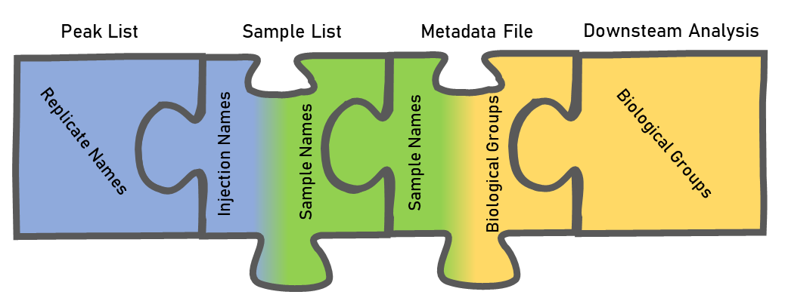
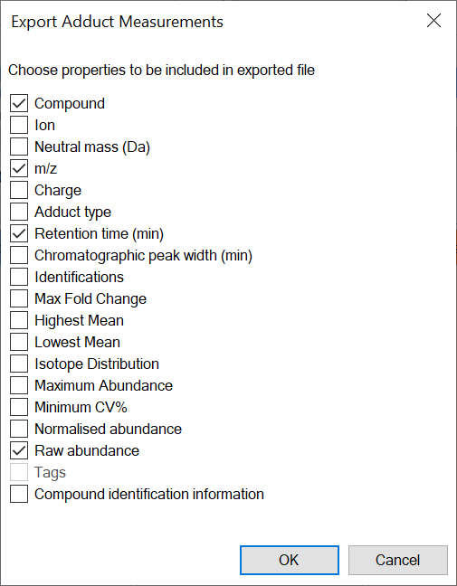
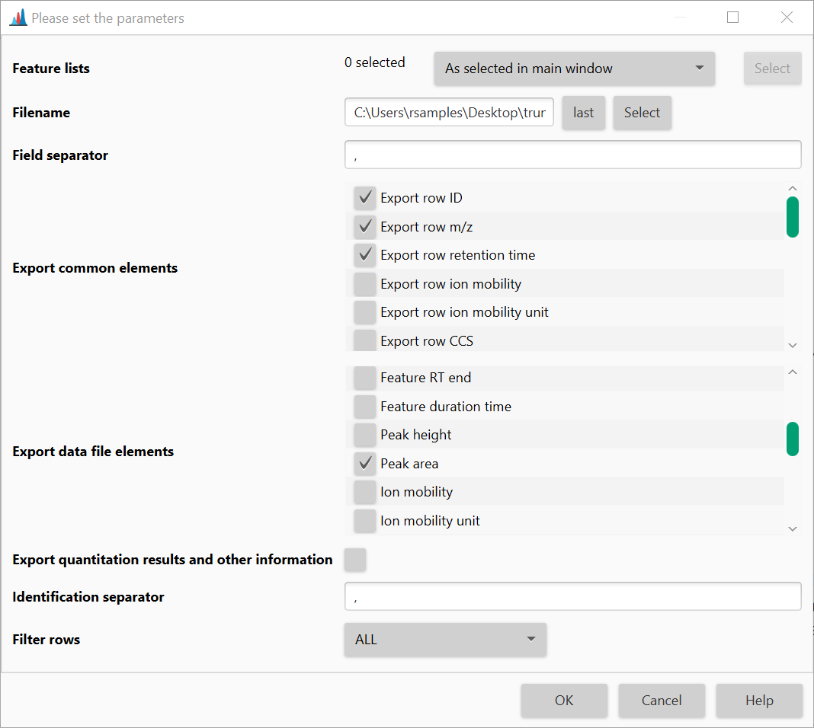
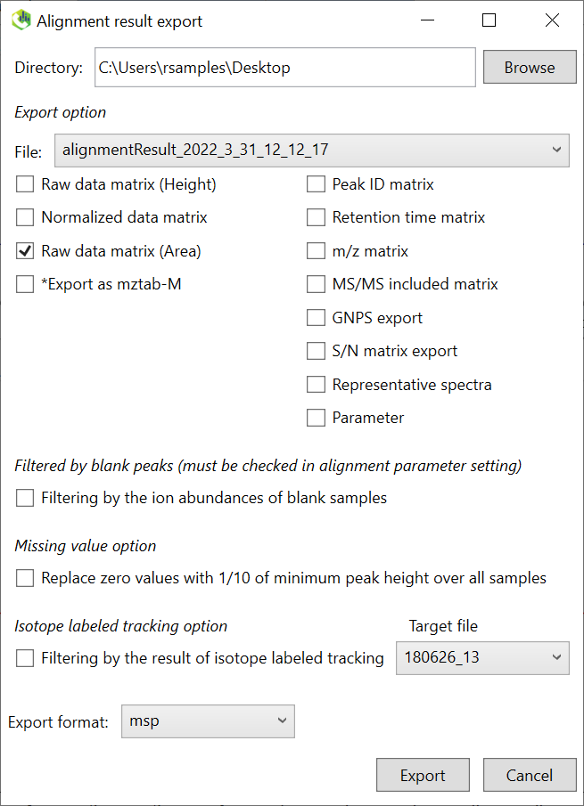
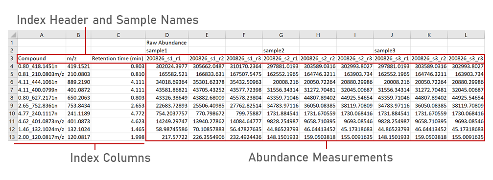
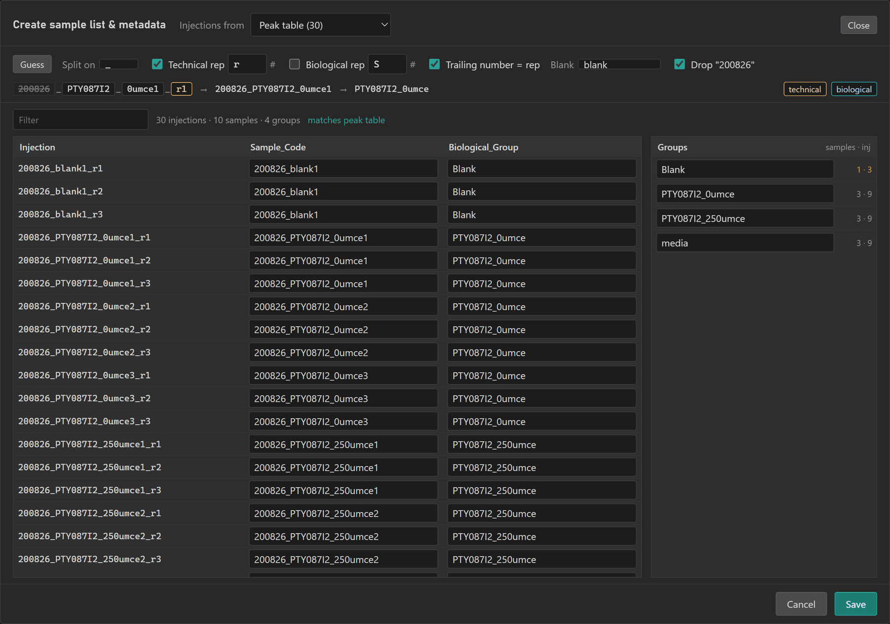
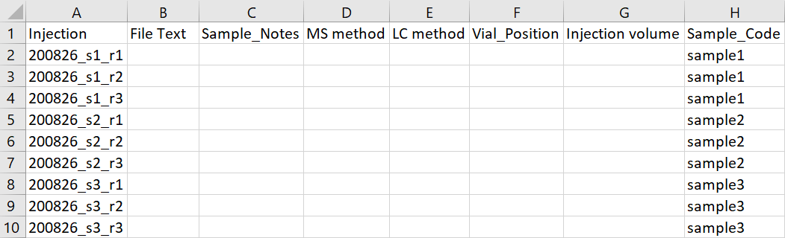
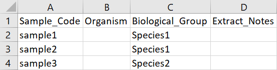

# Input files

An analysis needs three files, plus one optional one:

1. A **peak table** from Progenesis QI, MZmine, MS-DIAL or Bruker Metaboscape.
2. A **sample list** that maps each injection (raw data file) to a sample code.
3. A **metadata file** that maps each sample code to a biological group.
4. Optionally, a **fragment database** (`.msp` or `.mgf`) with MS2 spectra for
   the features.

A peak table has one column per injection, but the questions you want to answer
are about biological groups. The sample list and metadata file connect the two:
injections that share a sample code are technical replicates, and samples that
share a biological group are biological replicates.

<figure markdown="span">
  
  <figcaption markdown="span">The sample list links injection names to sample names, and the metadata file links sample names to biological groups.</figcaption>
</figure>

Technical replicates (repeat injections of each sample) are strongly
recommended. MPACT's reproducibility filter and its error propagation both use
them.

You do not have to write the sample list and metadata by hand. If your
injection names follow a pattern, MPACT
[builds both from the peak table](#automatic-build-them-from-injection-names).

## Peak table

The format is detected from the file's content, not its name or extension, and
converted automatically. Peak tables are uploaded as `.csv` or `.txt`.

!!! note "Export dialogs change between versions"
    The screenshots below come from older versions of each program. Menu
    names may have moved, but the export path is the same.

=== "Progenesis QI"

    In **Review Compounds**, choose **File > Export Compound Measurements** and
    export raw or normalized abundance. Include the compound, m/z and retention
    time columns.

    <figure markdown="span">
      { width="360" }
      <figcaption markdown="span">Progenesis QI export options.</figcaption>
    </figure>

=== "MZmine"

    Build an aligned feature list, then choose **Feature list methods > Export
    feature list > CSV (legacy MZmine 2)**. Export the row ID, m/z, retention
    time and peak area.

    <figure markdown="span">
      { width="560" }
      <figcaption markdown="span">MZmine CSV export options.</figcaption>
    </figure>

=== "MS-DIAL"

    Choose **Export > Alignment result** and export **Raw data matrix (Area)**.
    MPACT reads the `.txt` and `.csv` exports from MS-DIAL 5.4 and 5.5. To view
    MS2 spectra, also export the alignment's spectra as MSP and upload that as
    the fragment database.

    <figure markdown="span">
      { width="420" }
      <figcaption markdown="span">MS-DIAL alignment export options.</figcaption>
    </figure>

=== "Metaboscape"

    Export the feature table as a CSV file.

### Other software

To use a peak table from a program MPACT does not support, rearrange it into
the Progenesis layout, by hand or with a short script. Only the third header
row matters: it must hold the index headers (`Compound`, `m/z`,
`Retention time (min)`) followed by one column per injection, named exactly as
in your sample list. The first two header rows can be left blank, since groups
come from the sample list and metadata.

<figure markdown="span">
  
  <figcaption markdown="span">A peak table in Progenesis layout. The third header row holds the index columns and the injection names.</figcaption>
</figure>

## Sample list and metadata

There are two ways to provide these: let MPACT build both from your injection
names, or write them yourself.

### Automatic: build them from injection names

Most injection names already say which sample and replicate they are, for
example `200826_PTY087I2_0umce1_r1` (sample `0umce1`, technical replicate `r1`).
MPACT can read those names and write both sheets for you:

1. Select the peak table on **File Selection**.
2. Click **Create…** next to **Sample List** or **Sample Metadata**.
3. MPACT reads the injection names from the peak table, guesses the naming
   rules, and fills in a sample code and a biological group for every
   injection.
4. Check the table and the group list on the right. Adjust the rules or
   overwrite any cell that is wrong.
5. Click **Save**. Both sheets are saved to your library and selected.

<figure markdown="span">
  
  <figcaption markdown="span">The sample sheet editor reading the demo dataset's 30 injection names. `200826_PTY087I2_0umce1_r1` becomes sample `200826_PTY087I2_0umce1` in group `PTY087I2_0umce`.</figcaption>
</figure>

This works best when injection names follow a few conventions:

- Separate the parts of a name with a consistent character, such as `_`.
- Mark technical replicates with a consistent prefix and number (`r1`, `r2`,
  `r3`), and biological replicates likewise if they are numbered separately
  (`S1`, `S2`).
- Include `blank` in the name of every solvent blank.

Every option in the editor is described under
[Creating the sample list and metadata](file-selection.md#creating-the-sample-list-and-metadata).

### Manual: write them yourself

If your names do not follow a pattern, or you already keep these sheets, write
the two CSV files yourself or export them from your instrument's sample queue.

#### Sample list

A CSV with an `Injection` column (the injection names used in the peak table)
and a `Sample_Code` column. Other columns are ignored, so an export of your
instrument's sample queue usually works once those two columns are named.

<figure markdown="span">
  
  <figcaption markdown="span">A sample list. Only the Injection and Sample_Code columns are used.</figcaption>
</figure>

#### Metadata file

A CSV with a `Sample_Code` column and a `Biological_Group` column. Other
columns are ignored.

<figure markdown="span">
  { width="460" }
  <figcaption markdown="span">A metadata file. Only the Sample_Code and Biological_Group columns are used.</figcaption>
</figure>

Name your solvent blanks consistently (for example `Blank`), since blank
filtering removes features found in one group you choose.

### Shared sheets

A sample list and metadata file may cover more samples than the peak table.
This lets a class or a lab keep one combined pair of sheets for many datasets.
Each analysis uses only the rows its peak table needs. Repeated rows, which
appear when several sheets are pasted together, are merged rather than treated
as an error. The automatic editor keeps the other datasets' rows unchanged when
it saves into a shared sample list.

## Fragment database

An `.msp` or `.mgf` file of MS2 spectra exported by the same software as the
peak table. With it, MPACT can:

- show each feature's MS2 spectrum in the details panel,
- search the spectra against the MS-DIAL MS/MS library
  (see [Feature Info](../results/feature-info.md#msms-library-search)),
- write a re-indexed copy for GNPS2 molecular networking
  (see [Downloads](../results/downloads.md#gnps2-files)).

Spectra are matched to features by compound ID first, and by m/z and retention
time when no ID matches. Progenesis writes neutral masses rather than adduct
m/z into its MSP files, which is why ID matching comes first.
