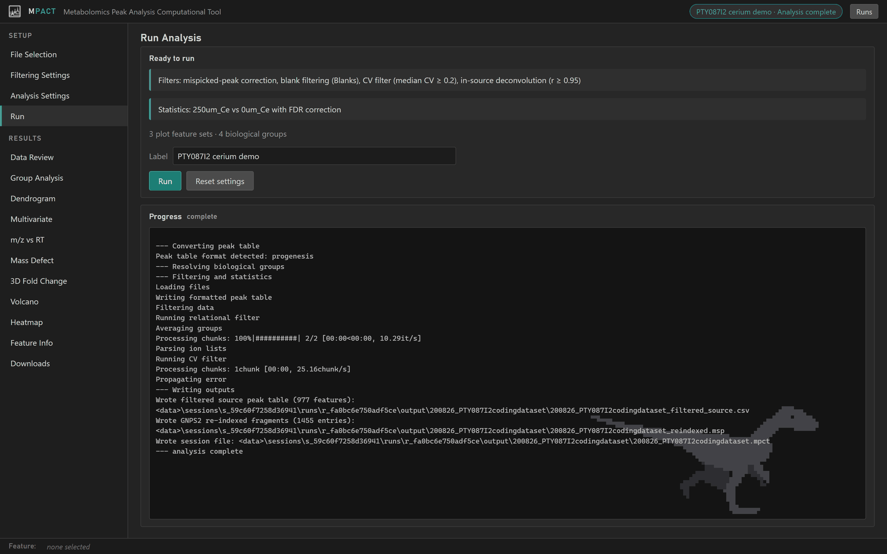
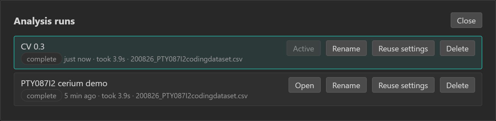

# Running and managing runs

## Starting a run

The **Run** tab summarizes the filters and the statistical comparison you have
set up. Give the run a **Label** if you like (you can rename it later) and
click **Run**.

<figure markdown="span">
  
  <figcaption markdown="span">The Run tab after the demo analysis has finished.</figcaption>
</figure>

The analysis runs on the server in its own process. Its log appears under
**Progress** as it goes, and the chip in the top bar shows the current stage.
The demo dataset takes a few seconds; a peak table with tens of thousands of
features can take a few minutes. You can leave the tab, or close the browser:
the run carries on, and the result is waiting when you come back.

**Cancel** stops a run in progress. **Reset settings** returns every setting on
the Filtering and Analysis pages to its default and removes your Plot Feature
Sets.

When the run finishes, the result tabs in the sidebar become available. If it
fails, the error is shown in the log, and the run stays in your list so you can
see what happened.

Some servers run only one or two analyses at a time. If yours is busy, the run
waits in a queue and starts by itself.

## Previous runs

**Runs** in the top bar lists every analysis in your workspace, newest first.

<figure markdown="span">
  
  <figcaption markdown="span">The list of analysis runs.</figcaption>
</figure>

- **Open** makes a run the active one. Every result tab then shows that run.
- **Rename** changes its label.
- **Reuse settings** loads the run's files, filters and Plot Feature Sets back
  into the Setup pages, ready to change and run again. This is the quickest
  way to try a different CV threshold or a different pair of groups.
- **Delete** removes the run and its output files.

Old runs may be deleted after a period of inactivity set by the server
operator. Download anything you want to keep from the
[Downloads](../results/downloads.md) tab.
